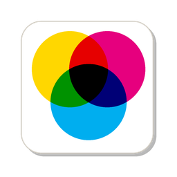
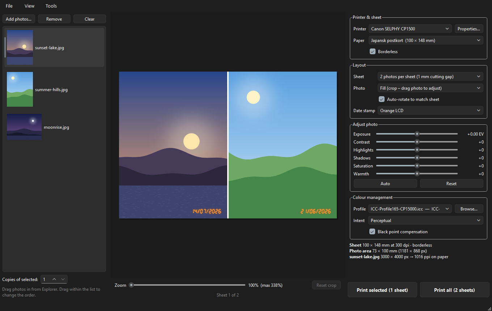
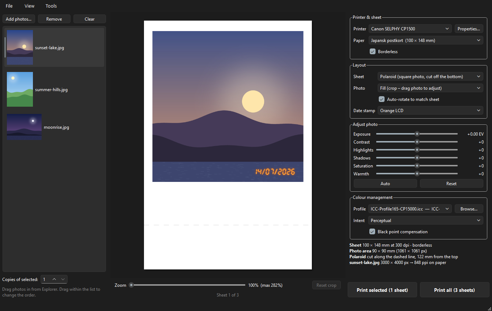

<p align="center">
  
</p>

<h1 align="center">Open DyePrint</h1>

<p align="center">
  Colour-managed photo printing for Windows, made for the Canon SELPHY CP1500.<br>
  Free and open source.
</p>

<p align="center">
  
</p>

## Why I made this

I'm not a professional photographer, just a dad who takes a lot of photos of his family
(the kids would say *way* too many). I edit my photos in
[RapidRaw](https://github.com/CyberTimon/RapidRaw) and print them at home on a Canon
SELPHY CP1500. The printer's own drivers and colour correction leave much to be desired,
however.

What I was missing was a quick and easy way to print to the SELPHY with a proper ICC
profile, without having to use Adobe or other paid, closed-source products. So, like any
reasonable person, I spent my evenings writing a print app instead. Open the photos, check
the preview, print. The colours come out the way they should, at the printer's full
resolution.

It's made for anyone who wants good prints from a small photo printer, whether you're a
professional or just someone who likes holding your photos in your hand. You know, like
in the old days.

## What it does

**Photos**
- Opens JPG, PNG, TIFF, WebP and **iPhone HEIC** files.
- Respects the photo's rotation and embedded colour profile (Display P3, Adobe RGB, ...).
- Add photos with the button, drag and drop, or right-click → *Print with Open DyePrint*
  in Explorer (switch it on under *Tools*).

**Layout**
- **1 photo per sheet**, **2 photos per sheet** (two 73 × 100 mm prints from one postcard,
  with a 1 mm line to cut along), or **Polaroid** (more about that below).
- Borderless printing on the SELPHY.
- **Drag** the photo in the preview to choose the crop and **zoom** with the mouse wheel.
  Zoom stops before the photo's resolution runs out, so zooming never makes the print soft.
- **Landscape photo on a portrait sheet?** It's turned to fit, or hit *Crop upright* to cut
  a portrait slice out of it instead.
- **Date stamp** like an old film camera: the date the photo was taken (dd/mm/yyyy) in
  orange, red or yellow LCD digits, or orange dot matrix.

**Colour**
- Pick your printer's **ICC profile**, rendering intent and black point compensation.
- Each photo is resampled once, straight to the printer's own 300 dpi, and Windows'
  colour management is switched off for the job. Your profile is the only colour
  conversion, so what you print matches what you edited.
- Simple adjustments per photo: exposure, contrast, highlights, shadows, saturation and
  warmth, plus an **Auto** button that gently fixes dark, bright or flat photos and leaves
  good ones alone.

**Printing**
- *Print selected* or *Print all*, with copies per photo.
- Tells you if the printer runs out of paper or ink, or goes offline.

## Polaroid-style prints

<p align="center">
  
</p>

Choose *Polaroid* as the layout and you get a square photo in a classic Polaroid-esque frame,
with the thin borders and the wide bottom margin. The frame fills the full width of the
paper, so you only cut once, along the dashed line, and you have a Polaroid-style print.

It's a cheap way to get the instant-photo look that Instax printers are known for:

| | SELPHY CP1500 + Open DyePrint | Instax Mini Link printer |
|---|---|---|
| Photo size | 90 × 90 mm | 62 × 46 mm |
| Pixels in the photo | about 1060 × 1060 | about 800 × 600 |
| Cost per print | about $0.40–0.70 (one postcard sheet) | about $0.85–1.00 (one Instax Mini shot) |
| Colour management | your own ICC profile | none |

So you get a bigger, sharper photo with accurate colours for roughly half the price. To be
fair, it isn't instant film: you don't get the dreamy film look or the fun of watching it
develop, and you need a pair of scissors or a paper cutter. But I think it's pretty neat.

## Download

1. Go to [Releases](../../releases) and download the latest `OpenDyePrint-x.y.z-windows.zip`.
2. Unzip it anywhere, e.g. `C:\Programs\OpenDyePrint`.
3. Run `OpenDyePrint.exe`. Keep the `_internal` folder next to it.

Windows SmartScreen will probably give you a suspicious look the first time, because the
app isn't signed with a (paid) code-signing certificate. Hobby budget. Click
**More info → Run anyway**.

Requires Windows 10 or 11 (64-bit). No Python needed for the download.

## Getting started with the SELPHY CP1500

1. **Connect the printer to your Wi-Fi** (on the printer: Wi-Fi settings) and add it in
   Windows: *Settings → Bluetooth & devices → Printers & scanners → Add device*.
   Windows uses its built-in driver for it. There's no Canon driver for Windows, and you
   don't need one.
2. **Get an ICC profile** for the SELPHY. I use two, and both are really great:
   - the [Canon SELPHY CP1500 ICC profile from Farbenwerk](https://www.farbenwerk.com/en/blogs/news/canon-selphy-cp1500-icc-profile),
   - the [Canon SELPHY ICC profile from Objektiv-Guide](https://www.objektiv-guide.de/icc-profil-canon-selphy/).

   Big shout-out to both of them! Put the `.icc` file in
   `C:\Windows\System32\spool\drivers\color`, or pick it with *Browse...* in the app.
3. **Turn off the printer's own auto-correction** in its settings, so it doesn't change
   colours on top of your profile.
4. Open Open DyePrint, add some photos, check that the SELPHY, your paper and your
   profile are selected, and hit *Print*.

**Tips**
- *Two photos per sheet:* the order in the list decides which photos share a sheet. Drag
  to reorder. With an odd number of photos, the last one gets printed full size.
- *Polaroid:* cut along the dashed line (122 mm from the top on a postcard). The info
  panel tells you where.
- *Glossy, semi-gloss or matte:* the SELPHY doesn't let Windows choose the finish. Set it
  on the printer itself.

## How it works

The short version: Open DyePrint renders every sheet itself, at exactly the printer's
resolution and in the printer's colour space, and hands Windows a finished bitmap with all
of Windows' scaling and colour management switched off. Borderless printing on the
SELPHY needs a small trick with Windows print tickets.

The long version is in [docs/how-it-works.md](docs/how-it-works.md).

## Run from source

You need Python 3.10 or newer.

```bat
git clone <this repo>
cd open-dyeprint
run.bat
```

`run.bat` creates a virtual environment in `.venv` on the first run, installs everything
and starts the app.

- Run the tests: `.venv\Scripts\python -m pytest`
- Build the `.exe`: `build.bat` (output in `dist\OpenDyePrint\`)

More in [CONTRIBUTING.md](CONTRIBUTING.md).

## Limitations

- **Windows only.** Printing goes straight through Windows' printing APIs.
- **Only tested on the Canon SELPHY CP1500**, for the simple reason that it's the printer I
  own. Other printers with a normal Windows driver should work, but I haven't tried them.
  Let me know how it goes.
- **No finish setting** (glossy/semi-gloss/matte), see above. Blame the printer, not me.
- 8-bit processing, and no soft proofing (preview of how the print will look on paper) yet.

## Ideas for later

- Soft proofing: simulate the paper on screen.
- Print sharpening.
- Remember crops and adjustments per photo between sessions.
- More layouts.

Ideas and bug reports are welcome in [Issues](../../issues). Pull requests even more so.

## Licence

[MIT](LICENSE). Use it, change it, share it. The Windows download also contains some
third-party libraries, listed in [THIRD-PARTY-NOTICES.md](THIRD-PARTY-NOTICES.md).

Open DyePrint is not affiliated with Canon, Fujifilm or Polaroid. All trademarks belong to their respective owners.
